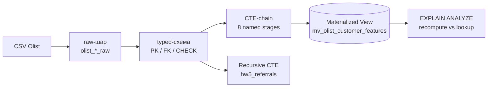

# HW5: Feature Engineering Pipeline на PostgreSQL (Olist)

[](https://colab.research.google.com/drive/1aYgBVIl_qBttZxxm2vuGCwmZ5zep530H?usp=sharing)


[](https://www.kaggle.com/datasets/olistbr/brazilian-ecommerce)

Відтворюваний SQL-pipeline, який будує **customer-level feature store** для ML-моделей прогнозування поведінки клієнтів на основі [Olist Brazilian E-commerce Dataset](https://www.kaggle.com/datasets/olistbr/brazilian-ecommerce).



---

## Зміст

- [Структура репозиторію](#структура-репозиторію)
- [Швидкий старт](#швидкий-старт)
- [Дані](#дані)
- [Pipeline](#pipeline)
- [Результати](#результати)
- [Висновки (Reflection)](#висновки-reflection)

---

## Структура репозиторію

```text
.
├── hw05_olist.ipynb    # notebook з кодом, виводами та Reflection
├── requirements.txt    # Python-залежності
└── README.md
```

## Швидкий старт

### Google Colab (рекомендовано)

1. Відкрийте notebook за кнопкою **Open in Colab** вище.
2. Виберіть **Runtime → Restart session and run all**.

Перша клітинка сама встановить PostgreSQL і Python-пакети. Повний прогін займає ~2–3 хвилини.

### Локально (Linux / WSL)

```bash
sudo apt-get install -y postgresql
sudo service postgresql start
sudo -u postgres psql -c "ALTER USER postgres PASSWORD 'postgres';"

python -m venv .venv && source .venv/bin/activate
pip install -r requirements.txt
jupyter notebook hw05_olist.ipynb
```

> [!NOTE]
> Клітинки з `!apt-get` / `!service` розраховані на Colab. Локально PostgreSQL ставиться один раз командами вище, а ці рядки можна пропустити.

## Дані

Notebook завантажує CSV автоматично, без ручних кроків:

| Пріоритет | Джерело | Деталі |
|:-:|---|---|
| 1 | Kaggle (`kagglehub`) | `olistbr/brazilian-ecommerce` |
| 2 | GitHub-дзеркало (резерв) | [`spdrio/Brazilian-E-Commerce-Public-Dataset-by-Olist`](https://github.com/spdrio/Brazilian-E-Commerce-Public-Dataset-by-Olist) → `/tmp/olist_mirror` |

| Typed-таблиця | Рядків | Ключ |
|---|--:|---|
| `olist_customers` | 99 441 | `customer_id` |
| `olist_orders` | 99 441 | `order_id` |
| `olist_order_items` | 112 650 | `(order_id, order_item_id)` |
| `olist_products` | 32 951 | `product_id` |
| `olist_sellers` | 3 095 | `seller_id` |

Кількість рядків у raw і typed шарах **збігається** (`delta = 0`). Усі рядки пройшли PK / FK / CHECK constraints.

> [!IMPORTANT]
> * У CSV колонки називаються `product_name_lenght` / `product_description_lenght` (саме з помилкою). У typed-схемі вони нормалізовані до `*_length`.
> * В Olist `customer_id` створюється **на кожне замовлення** (реальна людина — це `customer_unique_id`), тому майже в усіх клієнтів `frequency = 1`.
> * `hw5_referrals` — **синтетична** навчальна таблиця: Olist не має referral-даних.

## Pipeline

### 1. CTE-chain (8 named stages)

| Stage | CTE | Що обчислює |
|:-:|---|---|
| 0 | `reference_date` | стабільна дата відліку `MAX(order_purchase_timestamp)::date + 1` = **2018-10-18** |
| 1 | `stage1_orders_total` | order-level grain, `order_total = Σ(price + freight_value)` |
| 2 | `stage2_rfm` | `recency_days`, `frequency`, `monetary` |
| 3 | `stage3_cohort` | `cohort_quarter = DATE_TRUNC('quarter', first_order_date)` |
| 4 | `stage4_rolling_aov` | `avg_order_value_30d` — `AVG() OVER (RANGE INTERVAL '30 days' PRECEDING)` |
| 5 | `stage5_cancel_rate` | `cancellation_rate` |
| 6 | `stage6_category_revenue` | revenue per (customer, category) |
| 7 | `stage7_preferred_category` | top-1 категорія через `ROW_NUMBER()` |

Recency рахується від `reference_date`, а не від `CURRENT_DATE`. Так ознаки на історичному датасеті не змінюються з кожним днем, і pipeline залишається відтворюваним.

### 2. Recursive CTE: referral chain

- **Anchor:** корені дерева через NULL-safe `NOT EXISTS` (а не `NOT IN`).
- **Recursive part:** перехід referrer → referred, результат — `depth`, `path_ids`, `path_text`.
- **Termination:** cycle guard `NOT next_id = ANY(path_ids)` і depth guard `depth < 50`.
- Окреме демо циклу `A → B → C → A` з path-guard і з `CYCLE`-clause (PostgreSQL 14+).

### 3. Materialized View

`mv_olist_customer_features` містить повний 8-stage pipeline (99 441 рядок, один на клієнта).

- `UNIQUE INDEX` на `customer_id`. Це обов'язкова умова для `REFRESH MATERIALIZED VIEW CONCURRENTLY`.
- Додатковий індекс `(monetary DESC NULLS LAST)` для top-N читання.

## Результати

`EXPLAIN (ANALYZE, BUFFERS)`, Colab, PostgreSQL 16.15:

| Сценарій | Ключові вузли плану | Час | Shared buffers |
|---|---|--:|--:|
| RFM-частина pipeline (5.1) | `Merge Left Join`, `GroupAggregate`, `HashAggregate` (spill 7.4 MB) | 1 526 ms | 105 261 |
| Повний 8-stage pipeline (5.2) | `Sort external merge`, `WindowAgg`, `HashAggregate`, `Parallel Hash Join` | **3 650 ms** | **111 708** |
| MV lookup за `customer_id` (5.3) | `Index Scan using idx_mv_…_customer_id` | **0.130 ms** | **8** |
| MV top-10 за `monetary` (5.4) | `Index Scan using idx_mv_…_monetary` (без `Sort`) | 0.131 ms | 13 |

**Lookup із MV у ~28 000 разів швидший за повний перерахунок і читає в ~14 000 разів менше buffers.**

Розбивка повного pipeline за ознаками (з плану 5.2):

| Ознака | ≈ час | Що коштує |
|---|---|---|
| `preferred_category` | 895 ms | власний join orders × items × products, 2 × `Sort external merge`, `WindowAgg` |
| `avg_order_value_30d` | 590 ms | `Sort external merge` 9.4 MB + 2 × `WindowAgg` |
| `stage1_orders_total` (база) | 444 ms | `Merge Left Join` + `GroupAggregate`, 103 453 buffers |
| RFM | 300 ms | `HashAggregate`, 21 batch, spill 7.4 MB |
| `cancellation_rate` | 270 ms | `HashAggregate`, 21 batch, spill 7.2 MB |

> [!TIP]
> Час між прогонами в Colab помітно коливається (той самий запит у 5.5 дав 3.3–4.8 s), тому для порівняння стабільніші **buffers**, ніж мілісекунди.

## Висновки (Reflection)

Повний текст — у розділі **6. Reflection** notebook. Коротко:

1. **Найдорожче** — `preferred_category` і rolling AOV. Час іде на `Sort` / `HashAggregate` зі spill на диск (`work_mem` = 4 MB) і на window functions, а не на JOIN-и (`Parallel Hash Join` ≈157 ms).
2. **MV варто використовувати.** Читання займає частки мілісекунди через `Index Scan`, а refresh коштує ≈3.5 s. Оптимально — **щодобовий** `REFRESH … CONCURRENTLY` після ETL (для статичного Olist достатньо on-demand).
3. **VIEW** кращий для ad-hoc / debug запитів, ознак, що швидко змінюються, і малих обсягів даних.
4. **Recursive CTE** зупиняється завдяки path-guard і depth-guard. Цикл `A → B → A` відсікається на поверненні в `A`.
5. **Головний trade-off** — recompute-cost vs freshness: приймаємо застарілість до 24 год в обмін на дешеві читання. Storage-cost незначний.
